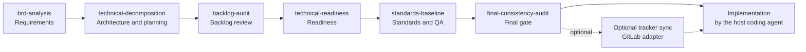

# Code Planner

**From Requirements to Production.**

AI Engineering Skill Library - a collection of reusable AI engineering skills covering the complete software development lifecycle.

Code Planner is not an application, framework, or runtime. It is a modular library of `SKILL.md` packages that AI coding agents can discover, install, and activate through the Agent Skills ecosystem and the Vercel Skills CLI.

## Table of Contents

- [1. What is Code Planner?](#1-what-is-code-planner)
- [2. Core Capabilities](#2-core-capabilities)
- [3. Skill Catalog](#3-skill-catalog)
- [4. Installation](#4-installation)
- [5. Usage Guide](#5-usage-guide)
- [6. Supported Agents](#6-supported-agents)
- [7. Repository Structure](#7-repository-structure)
- [8. Quality and Compatibility](#8-quality-and-compatibility)
- [9. Contributing](#9-contributing)
- [10. License and Project Information](#10-license-and-project-information)

## 1. What is Code Planner?

Code Planner helps AI coding agents apply a disciplined engineering process instead of improvising from a blank prompt. It provides reusable skills for requirements analysis, architecture and technical planning, standards baselines, readiness reviews, final audits, and optional Issue-tracker synchronization.

The library is designed around five principles:

- **Modular**: each skill can be installed and used independently.
- **Self-contained**: an installed skill carries the standards and references it needs.
- **Agent-agnostic**: no dependency on a specific model, LLM provider, or coding agent.
- **Contract-first**: architecture, data, API, and integration contracts are established before parallel implementation.
- **Tracker-agnostic**: core skills use an Issue tracker abstraction; GitLab synchronization is an optional adapter.
- **Evidence-based**: skills distinguish facts, assumptions, decisions, and unverified items.

Code Planner stops at implementation readiness and Issue-tracker preparation. It does not include a feature-coding skill because the source workflows do not define one. Implementation is executed by the host coding agent against approved Issues and the shared engineering standards included in the relevant skills.

## 2. Core Capabilities

| Capability | Delivered by | Notes |
|---|---|---|
| Requirements Analysis | `brd-analysis` | Source discovery, evidence classification, business processes, rules, data, roles, acceptance criteria, traceability |
| Product and Technical Planning | `technical-decomposition`, `backlog-audit` | Architecture, contracts, 5-level decomposition, dependency-minimized task catalog, backlog audit |
| Architecture and System Design | `technical-decomposition` | System context, boundaries, data ownership, API/integration contracts, ADRs |
| Development and Implementation | Shared standards in `coding-standards`, `security-standards`, `testing-standards`, `quality-gates` | No dedicated coding skill; implementation runs against approved tasks and standards |
| Testing and Quality Assurance | `standards-baseline`, `technical-readiness`, `final-consistency-audit` | Test strategy, coverage policy, CI gates, readiness and final audit |
| Code Review and Security | `code-review`, `security-standards`, `final-consistency-audit` | Review axes, severity, secure coding baseline, audit checks |
| DevOps and Production Delivery | `git-delivery-standards`; optional `gitlab-backlog-sync` | Branching, merge, release, rollback guidance; GitLab is an optional adapter |
| Documentation and Handover | `brd-analysis`, `documentation-standards`, `final-consistency-audit` | Canonical documents, stable IDs, cross-references, baseline freeze |

## 3. Skill Catalog

Code Planner currently ships **seven** skills. Each skill name matches its directory under `skills/`.

| Stage | Skill | Responsibility | Use when | Primary output |
|---|---|---|---|---|
| Requirements | [`brd-analysis`](skills/brd-analysis/SKILL.md) | Analyze business sources and produce a traceable BRD, including a clean-slate rebuild mode | Raw business material must become structured requirements | BRD package with traceability and open questions |
| Planning | [`technical-decomposition`](skills/technical-decomposition/SKILL.md) | Convert approved requirements into architecture, contracts, decomposition, and a parallel task catalog | A BRD/FS is approved and technical planning is needed | Architecture, contracts, task catalog, Issue-ready backlog |
| Planning | [`backlog-audit`](skills/backlog-audit/SKILL.md) | Read-only audit of an existing backlog for coverage, duplication, scope drift, dependencies, and ownership | A backlog or Issue tracker exists and must be verified | Coverage matrix, Issue classification, change plan |
| Readiness | [`technical-readiness`](skills/technical-readiness/SKILL.md) | Assess API/data, architecture, implementation, integration, backlog, standards, CI, performance, and security readiness | The project is preparing for implementation | Readiness report: READY / NEEDS IMPROVEMENT / BLOCKED |
| Standards | [`standards-baseline`](skills/standards-baseline/SKILL.md) | Establish and verify coding, testing, CI, security, review, documentation, DoR/DoD, and exception standards | The project needs a practical standards baseline | Standards baseline, validation results, recommendation |
| Assurance | [`final-consistency-audit`](skills/final-consistency-audit/SKILL.md) | Cross-document and backlog audit, evidence-based corrections, baseline freeze, GO/NO-GO | The project is preparing to synchronize and implement | Final baseline, findings, GO / CONDITIONAL GO / NO-GO |
| Optional integration | [`gitlab-backlog-sync`](skills/gitlab-backlog-sync/SKILL.md) | Idempotent GitLab backlog synchronization after approval | The project uses GitLab, GO exists, and the user explicitly approves writes | Issues, mapping table, sync report |

### How the Skills Work Together



The flow is a default sequence, not a hard-coded pipeline. The GitLab synchronization step is optional. A project may skip a step only when the user explicitly requests it and the risk is recorded.

## 4. Installation

### 4.1. Prerequisites

- Node.js 22.20 or later (required by the Vercel Skills CLI).
- `npm` and `npx` available.
- A coding agent that supports Agent Skills or the Vercel Skills CLI.

### 4.2. Install the Whole Library

```bash
npx skills add gungoan/code-planner
```

The repository remote is `gungoan/code-planner`. GitHub installation requires the repository to be pushed and accessible.

### 4.3. List Available Skills

```bash
npx skills add gungoan/code-planner --list
```

### 4.4. Install One Skill

```bash
npx skills add gungoan/code-planner --skill technical-decomposition
```

Install multiple skills by name:

```bash
npx skills add gungoan/code-planner --skill brd-analysis technical-decomposition
```

### 4.5. Choose an Agent

```bash
npx skills add gungoan/code-planner -a claude-code
npx skills add gungoan/code-planner -a codex
npx skills add gungoan/code-planner -a cursor
npx skills add gungoan/code-planner -a opencode
npx skills add gungoan/code-planner -a github-copilot
```

Install to all agents supported by the CLI:

```bash
npx skills add gungoan/code-planner --all
```

### 4.6. Local Development Installation

To test installation without modifying this repository, use a separate project directory:

```bash
cd /path/to/test-project
npx skills add /path/to/code-planner --list
npx skills add /path/to/code-planner --skill technical-decomposition -a opencode --copy -y
```

Install all skills from the local repository to one agent:

```bash
npx skills add /path/to/code-planner --skill '*' -a opencode --copy -y
```

### 4.7. Update and Remove

The CLI provides update and removal commands:

```bash
npx skills update
npx skills remove <skill-name>
```

For local copy installs, update and removal behavior may vary. Reinstall from the source repository if an update is not detected, and verify removal in your environment.

## 5. Usage Guide

### 5.1. How Activation Works

Each skill has a `name` and a `description` in its YAML frontmatter. Agents use the description to decide when the skill is relevant. When activated, the agent reads `SKILL.md` and loads only the local `shared/` and `references/` files that the skill references.

Installed skills are self-contained. An installed skill directory contains:

```text
skills/<skill-name>/
├── SKILL.md
├── shared/       # standards needed by the skill
└── references/   # checklists and templates needed by the skill
```

### 5.2. Use by Development Stage

| Stage | Ask the agent | Skill activated |
|---|---|---|
| Requirements | "Analyze the documents in `docs/input` and produce a BRD." | `brd-analysis` |
| Planning | "Turn the approved BRD into architecture, contracts, and a backlog." | `technical-decomposition` |
| Backlog review | "Audit the current backlog for gaps and incorrect dependencies." | `backlog-audit` |
| Readiness | "Assess whether the project is technically ready for implementation." | `technical-readiness` |
| Standards | "Set up coding standards, CI gates, and DoR/DoD for this repository." | `standards-baseline` |
| Final gate | "Run the final audit before release synchronization." | `final-consistency-audit` |
| Optional tracker sync | "GO is approved; synchronize the backlog to GitLab." | `gitlab-backlog-sync` |

### 5.3. End-to-End Example

1. **Analyze requirements**
   - Input: business documents, spreadsheets, slides, screenshots, existing notes.
   - Output: BRD, source inventory, traceability, open questions.

2. **Design and decompose**
   - Input: approved BRD/FS.
   - Output: architecture, data/API/integration contracts, 5-level decomposition, task catalog, parallel plan.

3. **Audit the backlog**
   - Input: existing tracker Issues and the approved specification.
   - Output: coverage matrix, Issue classification, change plan.

4. **Check readiness**
   - Input: contracts, backlog, codebase, CI configuration.
   - Output: READY / NEEDS IMPROVEMENT / BLOCKED with evidence.

5. **Establish standards**
   - Input: codebase, CI, approved architecture.
   - Output: standards baseline, test strategy, quality gates, DoR/DoD.

6. **Run the final audit**
   - Input: all documents, contracts, standards, and backlog.
   - Output: final baseline, findings, GO / CONDITIONAL GO / NO-GO.

7. **Optional: synchronize**
   - Input: GO decision, explicit approval, verified GitLab access.
   - Output: Issues, relationships, mapping table, sync report. Skip this step if the project does not use GitLab.

8. **Implement**
   - The host coding agent executes approved Issues using the standards included with the relevant skills.

### 5.4. Handoff Format

Each skill hands off with:

```text
STATUS: DONE | DONE_WITH_CONDITIONS | BLOCKED
ARTIFACTS
DECISIONS
OPEN QUESTIONS
RISKS
NEXT
EVIDENCE
```

This keeps multi-skill workflows traceable without requiring a specific project-management tool.

## 6. Supported Agents

The Vercel Skills CLI accepts the following agent IDs. Installation of `technical-decomposition` was verified locally for each agent listed as "CLI install verified."

| Agent | CLI ID | Status |
|---|---|---|
| Claude Code | `claude-code` | CLI install verified |
| OpenAI Codex | `codex` | CLI install verified |
| Cursor | `cursor` | CLI install verified |
| OpenCode | `opencode` | CLI install verified |
| GitHub Copilot | `github-copilot` | CLI install verified |
| Other Agent Skills-compatible agents | - | Specification-level compatibility; not individually tested |

**Verification scope:** installation was verified with the Vercel Skills CLI. Runtime activation and behavior on each agent were not tested in this repository. See [Quality and Compatibility](#8-quality-and-compatibility) for the exact test results.

## 7. Repository Structure

```text
code-planner/
├── skills/
│   ├── brd-analysis/
│   │   ├── SKILL.md
│   │   ├── shared/       # generated
│   │   └── references/   # generated
│   ├── technical-decomposition/
│   ├── backlog-audit/
│   ├── technical-readiness/
│   ├── standards-baseline/
│   ├── final-consistency-audit/
│   └── gitlab-backlog-sync/
├── shared/               # canonical cross-skill standards
├── references/           # canonical reference artifacts
├── scripts/
│   ├── sync-references.mjs
│   └── validate-skills.mjs
├── README.md
├── AGENTS.md
├── CONTRIBUTING.md
├── CHANGELOG.md
├── LICENSE
└── package.json
```

The tree is abbreviated: every skill folder has the same `SKILL.md` + generated `shared/` + `references/` shape.

### Canonical Sources and Packaged Copies

- `shared/` and `references/` at the repository root are the **canonical sources**.
- `skills/<name>/shared/` and `skills/<name>/references/` are **generated copies** that make each skill self-contained.
- Edit canonical sources, then run:

```bash
npm run sync
npm run validate
```

Do not edit generated copies directly.

## 8. Quality and Compatibility

### 8.1. Skill Quality Standard

Every skill is expected to define:

| Criterion | Requirement |
|---|---|
| Purpose | Clear goal and scope |
| Activation | Specific conditions for use |
| Inputs | Required context and artifacts |
| Workflow | Sequential, executable process |
| Decision Making | Rules, constraints, escalation |
| Outputs | Concrete deliverables |
| Quality Gates | Verification and completion criteria |
| Constraints | Prohibited actions and boundaries |
| Integration | Handoff and composition behavior |

### 8.2. Agent Skills Specification

Each skill uses:

- `SKILL.md` at `skills/<name>/SKILL.md`.
- YAML frontmatter with required `name` and `description`.
- Optional `license: MIT`.
- Lowercase-kebab-case `name` that matches the directory.
- No required vendor-specific frontmatter.
- No optional `compatibility` or `metadata` fields unless justified.

Official specification: [agentskills.io/specification](https://agentskills.io/specification).

### 8.3. Vercel Skills CLI Compatibility

Verified in this repository:

| Check | Result |
|---|---|
| Official `skills-ref validate` on all 7 skills | PASS |
| `npx skills add . --list` discovers all skills | PASS - 7 skills |
| Individual install of `technical-decomposition` | PASS - `opencode`, `claude-code`, `codex`, `cursor`, `github-copilot` |
| Multi-skill install (`--skill brd-analysis technical-decomposition`) | PASS - `opencode` |
| Full-library install of all 7 skills | PASS - `opencode`, 92 files |
| Installed package contains `SKILL.md`, `shared/`, `references/` | PASS |
| `npm run sync` and `npm run validate` | PASS - 7 skills, 10 shared standards, local references |
| GitHub remote install | NOT TESTED - remote is `gungoan/code-planner`, but no published commits were present |
| Update/remove commands | REMOVE reported success; a copied folder remained in the test environment. Update did not recognize the local copy install. Behavior depends on install mode; verify in your environment. |

Official CLI documentation: [github.com/vercel-labs/skills](https://github.com/vercel-labs/skills).

### 8.4. Validation Commands

```bash
npm run sync
npm run validate
npx skills-ref validate ./skills/<skill-name>
npx skills add . --list
```

### 8.5. Verification Boundary

- Skill format was validated with the official `skills-ref` validator.
- Installation and discovery were verified with the Vercel Skills CLI.
- Runtime activation and output quality depend on the host agent and model.
- No claim of universal agent compatibility beyond the Agent Skills specification and the CLI checks above.
- The GitHub remote was not published or pushed during this review.

## 9. Contributing

Read [`CONTRIBUTING.md`](CONTRIBUTING.md) before opening a pull request.

In short:

1. Create or update a skill under `skills/<name>/SKILL.md`.
2. Keep the skill name identical to the directory name.
3. Add required references to the canonical `references/` directory.
4. Register the skill and its references in both scripts.
5. Run `npm run sync` and `npm run validate`.
6. Verify CLI discovery and an independent installation.

## 10. License and Project Information

- **Project:** Code Planner
- **Repository:** `code-planner`
- **GitHub:** [github.com/gungoan/code-planner](https://github.com/gungoan/code-planner)
- **Tagline:** From Requirements to Production.
- **License:** MIT. See [`LICENSE`](LICENSE).
- **Skills ecosystem:** [skills.sh](https://skills.sh/)

Code Planner is a skill library, not an application framework. Its value is in reusable, inspectable, and installable engineering instructions that keep AI-assisted delivery traceable from requirements to production.
